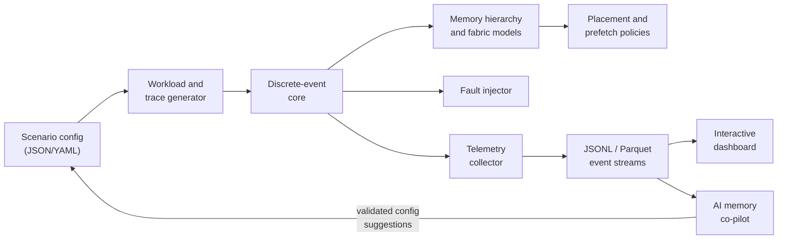
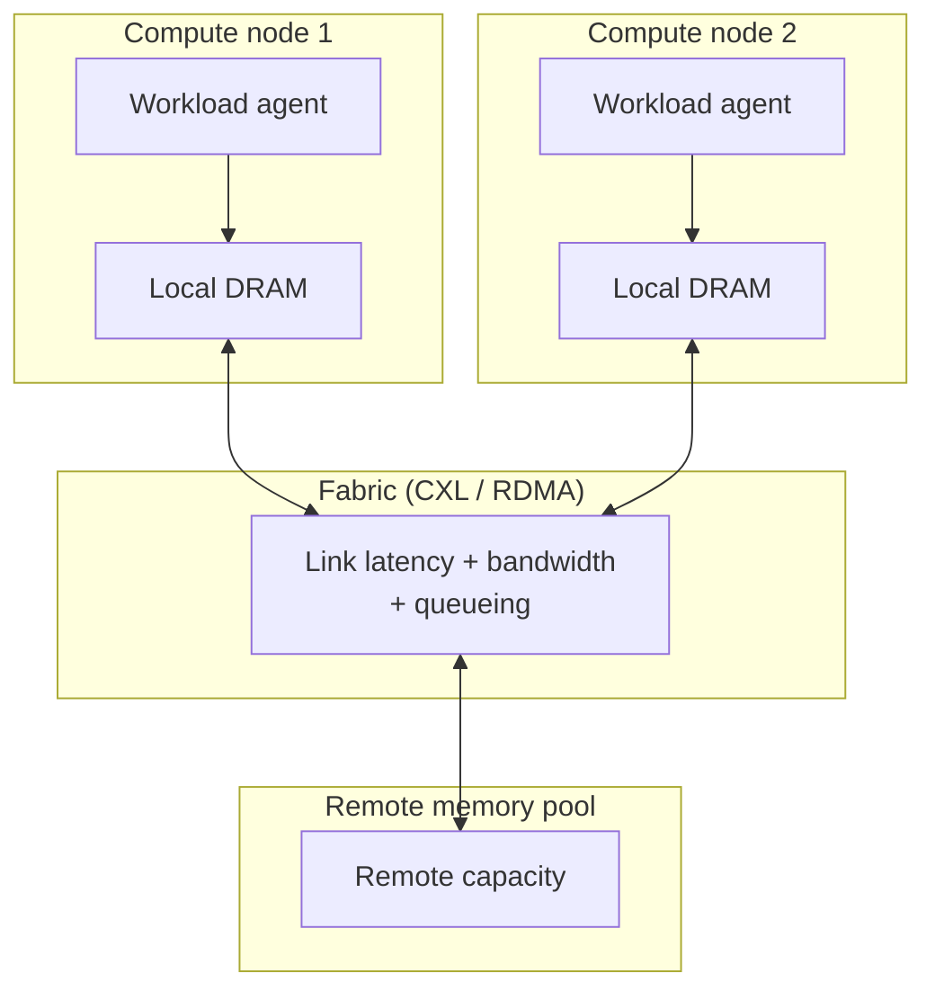

# RmemFab

**Remote Memory Fabric Simulator** — an interactive discrete-event simulator and AI co-pilot for modeling, benchmarking, and optimizing disaggregated remote-memory architectures for memory-intensive AI workloads.

> **Status:** active development. The architecture, simulation model, and scenario schemas are in this repository. The core engine and dashboard are being built for the [Muse AI Hackathon](https://luma.com/muse) (Indie track).

RmemFab gives infrastructure engineers a fast, reproducible sandbox for answering questions that are currently expensive to answer on real hardware:

- When does remote memory actually beat local DRAM + swap?
- Where is the latency cliff for a given CXL or RDMA fabric?
- Which page-placement and prefetching policy wins for a specific model and serving pattern?
- How gracefully does the system degrade when a memory node or fabric link fails?

Instead of standing up a disaggregated cluster for every experiment, describe the system in a scenario file, run the simulation, and compare policies under identical conditions.

---

## The problem

Memory-intensive AI workloads are outgrowing single-node DRAM:

- **LLM serving** grows a KV cache roughly linearly with context length, batch size, layers, and attention heads. Long-context serving can consume hundreds of gigabytes of accelerator-adjacent memory.
- **Large-scale training** and **Mixture-of-Experts (MoE)** models activate sparse subsets of parameters per token, producing bursty, hard-to-predict memory demand.
- **Disaggregated memory** — CXL-attached memory pools and RDMA-connected remote memory — promises elastic capacity, but it introduces a new design space: latency tiers, bandwidth contention, cache pollution, migration overhead, and failure modes.

Testing placement policies on physical CXL/RDMA hardware is slow, costly, and difficult to instrument reproducibly. RmemFab models the system analytically so engineers can explore that design space before committing to hardware.

## What RmemFab is

RmemFab is two cleanly separated layers:

1. **A deterministic discrete-event simulation core** that models workloads, memory tiers, fabric latency/bandwidth, caching, prefetching, migration, and faults. It emits structured telemetry.
2. **An interactive exploration layer** — a dashboard plus an AI memory co-pilot — that visualizes bottlenecks, compares policies side by side, and turns natural-language questions into validated scenario configurations.

The simulator does **not** execute GPU kernels or emulate hardware cycle by cycle. It is an analytical, trace-driven model intended for rapid policy exploration and pre-hardware screening. See [docs/FAQ.md](docs/FAQ.md) and [docs/SIMULATION-MODEL.md](docs/SIMULATION-MODEL.md) for scope and limitations.

## Who it is for

- **AI infrastructure engineers** deciding whether remote memory is viable for a serving or training workload.
- **Systems researchers** comparing tiering, migration, and prefetching strategies under controlled conditions.
- **Hardware and platform architects** exploring CXL/RDMA topology and capacity trade-offs.
- **Performance engineers** who need reproducible experiments instead of one-off benchmarks.

## Key capabilities

| Capability | What it does |
| :--- | :--- |
| **Workload modeling** | Generates KV-cache growth, prefill/decode phases, sparse attention lookups, MoE expert bursts, and multi-tenant request mixes. Imports measured traces from PyTorch/vLLM. |
| **Tiered memory hierarchy** | Models local DRAM, CXL-attached remote memory, RDMA memory pools, optional cache tiers, page migration, and prefetching at configurable page granularity. |
| **Fabric model** | Models per-link latency, bandwidth, queueing, contention, and congestion. Link and topology parameters are fully configurable. |
| **Policy comparison** | Runs baseline and candidate placement policies against the same seed and trace, with side-by-side metrics. Policies are pluggable. |
| **Fault injection** | Simulates node loss, intermittent fabric errors, packet loss, and degraded-mode operation. |
| **Reproducibility** | Seeded random streams, versioned scenario files, deterministic event ordering, and recorded run manifests. |
| **Telemetry and visualization** | Emits JSONL/Parquet event streams; renders latency distributions, hit-rate curves, memory heatmaps, fabric utilization, and bottleneck breakdowns. |
| **AI co-pilot** | Converts natural-language cluster descriptions into schema-validated scenarios, summarizes telemetry, and proposes policy changes grounded in simulator output. |

## Architecture at a glance



Detailed component responsibilities and interfaces are in [docs/ARCHITECTURE.md](docs/ARCHITECTURE.md).

## Simulated system model

A scenario describes compute nodes, one or more remote memory pools, and the fabric connecting them.



Each memory access is resolved against a tiered hierarchy. A miss can trigger remote fetch, migration, or prefetch according to the active policy. All timing is derived from configurable latency, bandwidth, and queueing parameters.

Starting hardware presets (all configurable, not guarantees):

| Tier | Approx. one-way latency | Approx. bandwidth | Notes |
| :--- | :--- | :--- | :--- |
| Local DRAM | 80–100 ns | 200–800 GB/s per socket | NUMA effects modeled as per-node links |
| CXL-attached memory (CXL 2.0/3.0) | ~170–250 ns | 32–64 GB/s per port | CXL.mem over PCIe/CXL fabric |
| RDMA remote memory (RoCE/InfiniBand) | ~1.5–3 µs | 100–400 Gbps per port | Higher latency; strong for capacity, weaker for hot pages |
| Local NVMe swap (optional) | ~10–100 µs | device-dependent | Baseline only; not the target medium |

See [docs/HARDWARE-MODELS.md](docs/HARDWARE-MODELS.md) for the model equations and calibration checklist.

## Workload profiles

RmemFab focuses on memory behavior, not FLOPs:

- **Prefill:** large, mostly sequential allocation and access for weights, activations, and prompt processing.
- **Decode / KV cache:** incremental, growing per-token KV allocations; memory-bound; long-lived pages; strong temporal locality per request.
- **Sparse attention:** irregular lookups over a large KV working set.
- **MoE routing:** sparse, bursty expert activation (`top-k` of `N` experts) with a working set much larger than the active set.
- **Multi-tenant serving:** interleaved request streams with different context lengths, arrival processes, and priorities.
- **Measured traces:** CUDA allocator snapshots and KV-cache access traces captured from PyTorch/vLLM on real GPUs and replayed in the simulator.

The trace format and generation strategies are described in [docs/WORKLOADS.md](docs/WORKLOADS.md).

## Policies

Policies are pluggable modules that observe accesses and capacity pressure and decide placement, eviction, migration, and prefetching. Out of the box, RmemFab is designed to compare:

- **Local-only** — no remote capacity; evict or fail on pressure.
- **Swap-to-remote** — remote memory treated as a slower backing store.
- **Hot/cold migration** — move pages based on recent access frequency.
- **Frequency-aware eviction** — protect frequently reused pages (LRU-K / ARC-style).
- **Predictive prefetching** — prefetch likely-next pages using detected access patterns.
- **Cost-aware / custom** — weigh latency, bandwidth, migration cost, and policy-specific signals.

Every policy sees the same seeded workload and the same starting state, so comparisons isolate the policy's effect. See [docs/POLICIES.md](docs/POLICIES.md).

## Metrics

RmemFab reports, per run and per policy:

- Access latency: mean, p50, p95, p99, max.
- Stall time and execution-time overhead versus local-only.
- Local and remote hit ratios.
- Remote read/write traffic and migration volume.
- Fabric utilization, queue depth, and congestion events.
- Throughput under a configured request-arrival model.
- A configurable cost model (capacity, transfer, and migration costs).

## AI memory co-pilot

The co-pilot is an optional layer on top of the deterministic core:

- **Natural language to scenario:** "Simulate 8 nodes with 200 Gbps RoCE and a 70B MoE model" becomes a schema-validated scenario file that the user can inspect and edit.
- **Telemetry explanation:** summarizes where latency comes from and which tier/link is the bottleneck.
- **Policy proposals:** suggests parameter or policy changes, then reruns the simulation with the same seed and reports the measured delta.
- **Grounded answers:** the co-pilot reasons over simulator telemetry, not invented numbers. Proposed runs are explicit and reproducible.

The co-pilot is model-agnostic. The planned hackathon build uses Meta open-weight models through partner inference endpoints, with workload profiling on serverless GPUs. None of these integrations are required for the core simulator, which runs fully offline and deterministically.

## Technology stack (planned)

| Layer | Choice |
| :--- | :--- |
| Simulation core | Python 3.11+, NumPy, Pydantic; priority-queue event loop. Optional Rust/PyO3 hot path later. |
| API and jobs | FastAPI, Uvicorn; background workers for parameter sweeps. |
| Dashboard | React/Next.js, TypeScript, Tailwind CSS, ECharts/visx; WebGL heatmaps for large traces. |
| Data | JSONL for event logs, Parquet for larger runs, DuckDB for ad-hoc analysis. |
| Workload capture | PyTorch and vLLM on serverless GPU workers; CUDA memory snapshots and KV-cache traces. |
| AI co-pilot | Provider-agnostic client for Meta open-weight models via partner inference APIs. |

## Repository layout

```text
RmemFab/
├── README.md
├── LICENSE
├── docs/
│   ├── ARCHITECTURE.md       # components, interfaces, data flow
│   ├── SIMULATION-MODEL.md   # event loop, timing, queueing, statistics
│   ├── WORKLOADS.md          # AI workload profiles and trace capture
│   ├── POLICIES.md           # policy interface and comparison protocol
│   ├── HARDWARE-MODELS.md    # latency/bandwidth equations and presets
│   ├── ROADMAP.md            # milestones and acceptance criteria
│   ├── GLOSSARY.md           # CXL, RDMA, KV cache, MoE, and related terms
│   ├── ACCEPTANCE.md         # executable checks for correctness, fairness, explainability
│   └── FAQ.md                # scope, non-goals, validation
├── SPECS/
│   ├── README.md             # specification versioning
│   ├── events.md             # event types and fields
│   ├── config.schema.json    # scenario configuration schema
│   └── trace.schema.json     # memory access trace record schema
└── examples/
    ├── llama-70b-cxl.json
    ├── moe-remote-tiering.json
    ├── policy-prefetch-failure.json
    └── phase1-overflow.json   # deliberately undersized local tier; proves the remote path
```

The core engine, API, and dashboard directories will be added as implementation lands. Specs are written first so the engine and UI can be developed independently.

## Design principles

1. **Deterministic by default.** Same scenario, seed, and version produce the same result. Random streams are independent per subsystem.
2. **Engine and UI are decoupled.** The core emits telemetry; the dashboard is a consumer. A UI failure cannot corrupt a run.
3. **Specs before code.** Event, scenario, and trace schemas are versioned contracts.
4. **Measured traces over guesses.** Synthetic profiles are useful; captured traces are better. Both are supported and labeled.
5. **Everything is configurable.** Latency, bandwidth, page size, queue depth, failure rates, and policy parameters live in the scenario, not in code.
6. **Explain the result.** Every metric should be traceable to an event and a parameter.

## Development workflow (planned)

```bash
git clone https://github.com/ENuel20/RmemFab.git
cd RmemFab
python3 -m venv .venv
source .venv/bin/activate
pip install -e ".[dev]"

rmemfab validate examples/llama-70b-cxl.json
rmemfab run examples/llama-70b-cxl.json --out runs/llama70b-cxl
rmemfab serve --runs runs/
```

Commands are targets for the first implementation milestone; see [docs/ROADMAP.md](docs/ROADMAP.md) for acceptance criteria.

## Roadmap

- **Phase 0 — Specification:** scenario, event, and trace schemas; simulation and policy contracts. *(in this repo)*
- **Phase 1 — Core engine:** single-node local memory, remote pool, fabric latency/bandwidth, LRU, metrics, CLI.
- **Phase 2 — Workloads:** KV-cache and MoE generators; trace import; calibration against captured traces.
- **Phase 3 — Policy suite:** migration, frequency-aware eviction, prefetching, and reproducible sweeps.
- **Phase 4 — Dashboard:** live telemetry, policy comparison, memory heatmaps, run history.
- **Phase 5 — Resilience and co-pilot:** fault injection, degraded-mode analysis, natural-language scenario authoring, grounded policy suggestions.
- **Phase 6 — Validation:** compare simulated predictions with measured CXL/RDMA behavior and publish error bounds.

## Acceptance criteria

Requirements are not considered met until a reproducible command demonstrates them. [`docs/ACCEPTANCE.md`](docs/ACCEPTANCE.md) defines the checks for correctness, provenance, fair comparison, workload realism, explainability, reproducibility, the dashboard, and the policy-failure result.

## Contributing

This repository is under active development. Issues and design discussions are welcome. Please keep changes aligned with the versioned schemas in [`SPECS/`](SPECS/) and include a reproducible scenario or test for behavioral changes.

## License

MIT. See [LICENSE](LICENSE).
