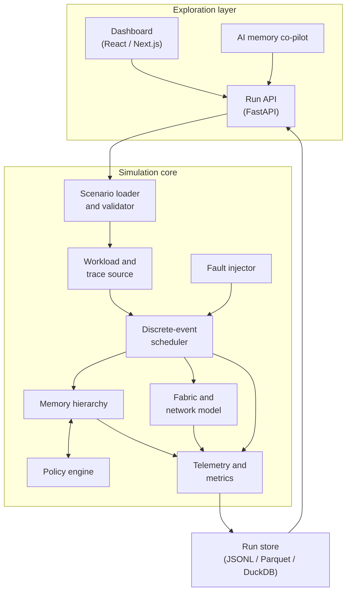
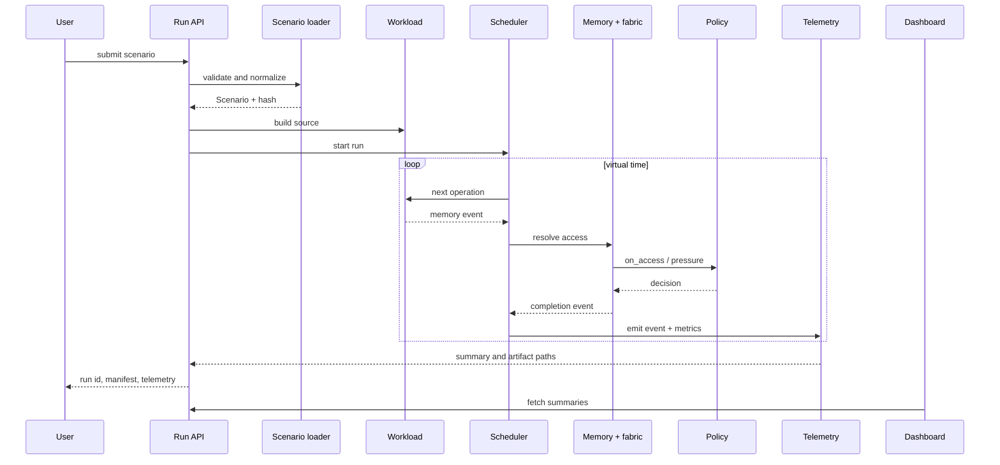

# Architecture

This document describes the planned component boundaries, interfaces, and data flow of RmemFab. The goal is to keep the simulation core deterministic and independent from the dashboard so that each layer can be developed, tested, and replaced on its own.

## System layers



## Components

### Scenario loader and validator

- Reads JSON or YAML scenario files.
- Validates against [`SPECS/config.schema.json`](../SPECS/config.schema.json).
- Resolves presets (for example `cxl-2.0`, `rdma-roce-200g`) into explicit parameters.
- Produces an immutable, normalized `Scenario` object.
- Records the scenario hash, RmemFab version, and schema version in the run manifest.

Failure behavior: invalid scenarios fail before any simulation starts. The validator reports the path to the offending field and the violated constraint.

### Workload and trace source

- Produces timestamped memory operations for the scheduler.
- Supports synthetic generators (KV-cache decode, prefill, sparse attention, MoE, mixed serving) and imported traces.
- Normalizes all inputs into the same internal event stream.
- Uses a dedicated seeded random stream so workload randomness is independent of policy randomness.

Synthetic sources can run in one of two modes:

- **Precomputed:** materialize a full trace, then replay it. Easier to inspect and compare.
- **On-demand:** generate the next operation when the scheduler needs it. Lower memory for long runs.

Both modes must produce identical sequences for the same seed and parameters.

### Discrete-event scheduler

- Maintains a priority queue keyed by `(time_ns, sequence_id)`.
- Dispatches events in nondecreasing virtual time; ties are broken by insertion sequence for determinism.
- Owns the virtual clock and the run lifecycle.
- Has no wall-clock dependence and no background threads.
- Emits telemetry as events are processed, not at the end, so long runs can be streamed.

See [SIMULATION-MODEL.md](SIMULATION-MODEL.md) for the event loop details.

### Memory hierarchy

Models:

- Local DRAM per compute node, with configurable capacity, latency, bandwidth, and page size.
- Remote memory pools, addressable over the fabric.
- Optional intermediate cache tiers.
- Page states: resident local, resident remote, in flight, evicted, prefetched.
- Address translation: the simulator works with abstract page identifiers, not real virtual addresses.

The memory model is responsible for accounting for capacity and for timing page operations. Policy decisions are delegated to the policy engine.

### Fabric and network model

Models links between nodes and memory pools:

- One-way latency, bandwidth, and maximum in-flight bytes.
- FIFO queues with configurable depth; queueing delay is added to transfer time.
- Optional path selection when multiple links connect the same endpoints.
- Congestion injection for fault experiments.

The fabric is intentionally simple and analytical. It is not a packet-level network simulator.

### Policy engine

- Calls policy hooks on access, capacity pressure, timer ticks, and faults.
- Returns decisions: keep, promote, demote, migrate, evict, prefetch, or no-op.
- Is deterministic given the same inputs and its own seeded random stream.
- Cannot mutate simulator state directly; it returns decisions that the memory model applies.

Policies are loaded by name from a registry, with parameters validated by Pydantic models.

### Fault injector

- Schedules failures from configured distributions or explicit timelines.
- Supports node failure/restart, link flapping, packet loss, and bandwidth degradation.
- Changes only simulated state; it never affects the host.
- Records every fault in the event log so results are explainable.

### Telemetry and metrics

- Emits structured events to JSONL by default; Parquet is an export target for large runs.
- Computes streaming aggregates (counters, histograms) so memory does not grow with run length.
- Writes a run manifest containing scenario hash, seed, RmemFab version, start time, and host metadata (without secrets).
- Supports warm-up exclusion and configurable percentile reporting.

### Run API

- Validates and submits scenarios.
- Starts, cancels, and queries runs.
- Streams progress and telemetry summaries.
- Lists and compares completed runs.
- Serves the dashboard's static assets in local development.

The API is a thin layer over the core. It must not contain simulation logic.

### Dashboard

- Displays live and historical runs.
- Compares policies using identical scenarios and seeds.
- Visualizes latency distributions, hit ratios, memory occupancy over time, fabric utilization, and migration traffic.
- Lets users edit scenario parameters and rerun.
- Never talks to the simulation core directly; it uses the run API.

### AI memory co-pilot

- Accepts natural-language requests and maps them to a scenario draft.
- Validates drafts with the same schema as manual scenarios; invalid drafts are rejected before running.
- Explains telemetry using retrieved run data and metric definitions.
- Proposes policy/parameter changes and launches comparison runs with the same seed.
- Clearly separates observations (from telemetry) from hypotheses (model suggestions).
- Is optional: disabling it leaves a fully functional simulator and dashboard.

## Determinism contract

A run is reproducible when the following are identical:

- RmemFab version.
- Scenario content (canonicalized and hashed).
- Seed.
- Trace input (content hash).
- Policy implementation version.

The engine must not depend on:

- Wall-clock time.
- Iteration order of hash maps or sets.
- Host CPU count or thread scheduling.
- Floating-point reductions whose order depends on runtime scheduling.

Randomness is partitioned into independent streams:

| Stream | Used by |
| :--- | :--- |
| `workload` | request arrivals, trace synthesis |
| `policy` | tie-breaking and randomized policy choices |
| `faults` | failure timing and target selection |
| `fabric` | optional loss and jitter |

Each stream is derived from the run seed and a stable stream name, for example `PCG64(SeedSequence(seed, spawn_key=(stream_id,)))`.

## Data flow



## Planned package layout

```text
src/rmemfab/
├── cli.py              # validate, run, serve
├── config/
│   ├── models.py       # Pydantic scenario models
│   ├── presets.py      # hardware and workload presets
│   └── validate.py     # schema + semantic validation
├── core/
│   ├── scheduler.py    # event queue and virtual clock
│   ├── events.py       # event dataclasses
│   ├── engine.py       # run lifecycle
│   └── rng.py          # seeded stream management
├── memory/
│   ├── hierarchy.py    # tiers, pages, capacity accounting
│   ├── fabric.py       # links, queues, transfers
│   └── faults.py       # fault injection
├── policies/
│   ├── base.py         # policy interface and registry
│   ├── baselines.py    # local-only, swap
│   ├── migration.py    # hot/cold
│   ├── eviction.py     # frequency-aware
│   └── prefetch.py     # predictive
├── workloads/
│   ├── synthetic.py    # KV, prefill, MoE, mixed
│   ├── trace.py        # trace parsing and replay
│   └── models.py       # model shape presets
├── telemetry/
│   ├── collector.py    # streaming metrics
│   ├── writers.py      # JSONL / Parquet
│   └── summary.py      # run summaries
├── api/
│   └── app.py          # FastAPI application
└── copilot/
    ├── client.py       # provider-agnostic model client
    ├── scenario.py     # NL -> scenario draft
    └── explain.py      # telemetry-grounded explanations
```

## Extension points

- **New policy:** implement the policy interface, register a name, add a parameter model, and add a comparison scenario.
- **New hardware model:** add a preset and, if the timing model differs, a link/tier class.
- **New workload:** implement a workload source that emits normalized memory operations.
- **New trace source:** add an importer that maps records to the trace schema.
- **New copilot provider:** implement the model client interface; the rest of the system is unaffected.

## Non-goals

- Cycle-accurate hardware emulation.
- Packet-level network simulation.
- GPU kernel execution or performance prediction.
- Replacing real profiling or hardware benchmarks.
- Multi-tenant security isolation inside the simulator.
