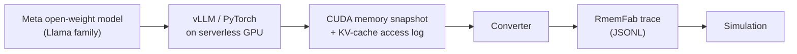

# Workloads and traces

RmemFab models memory behavior, not arithmetic. A workload source produces timestamped page operations; the rest of the simulator does not care whether those operations came from a synthetic generator or a captured trace.

## Why workload shape matters

Remote-memory policies are only as good as the access pattern they are tuned for. Two workloads with the same average bandwidth can have very different outcomes:

| Workload | Working set | Locality | Burstiness | Remote-memory fit |
| :--- | :--- | :--- | :--- | :--- |
| Prefill | Large, mostly sequential | High spatial | High | Good for cold activations; poor for hot weights |
| Decode / KV cache | Grows with context | High temporal per request | Low to moderate | Good when occupancy exceeds local DRAM |
| Sparse attention | Large and scattered | Low spatial, long reuse distance | Moderate | Sensitive to latency; prefetching helps selectively |
| MoE routing | Very large expert set | Sparse, bursty | High | Strong candidate for remote tiering |
| Multi-tenant serving | Mixed | Mixed | High | Requires per-request or per-tenant policy awareness |

RmemFab ships generators for these shapes and a replay path for measured traces.

## Synthetic generators

All generators emit normalized memory operations with page identifiers, sizes, and access kinds. They share a seeded random stream (`workload`) and are deterministic for a given seed.

### Prefill

Models the prompt-processing phase:

- Allocate weight, activation, and workspace pages.
- Stream prompt tokens through layers with large sequential reads.
- Mostly one-pass access with limited reuse after the layer completes.
- Optional overlap with other requests.

Parameters: prompt length, batch size, layer count, hidden size, dtype, number of concurrent prefills.

The generator produces large sequential runs, which makes it useful for testing bandwidth saturation and write-back behavior.

### Decode and KV cache

Models autoregressive token generation:

- Each request owns a KV cache that grows by one token per decode step.
- New KV pages are allocated per layer per token; old pages remain live for the request.
- Attention reads a growing window of KV pages; recent pages are hotter than old ones.
- When local capacity is exhausted, the policy decides what to keep, migrate, or evict.

Parameters: context length, batch size, layers, KV heads, head dimension, dtype, tokens per second, request arrival rate, maximum concurrent requests.

Approximate KV size per token:

```text
2 * layers * kv_heads * head_dim * dtype_bytes
```

The generator exposes this estimate as telemetry so users can sanity-check the scenario before running a long simulation.

### Sparse attention

Models workloads where attention touches a large but irregular subset of KV pages:

- A long-context request with a sparse attention mask.
- Access distances drawn from a configured distribution (for example local window plus random global tokens).
- Reuse distance often exceeds cache capacity.

Parameters: context length, sparsity pattern, window size, global-token count, request count.

This profile stresses prefetching and eviction: sequential prefetchers can be useless or harmful, while pattern-aware prefetch can help.

### MoE routing

Models Mixture-of-Experts inference and training:

- A large expert parameter set lives across tiers.
- Each token activates `top_k` of `N` experts.
- Expert popularity is skewed (a small set is hot).
- Activation bursts create transient demand spikes.

Parameters: expert count, top-k, expert size, popularity distribution (uniform, Zipf), tokens per batch, layer count.

This is the clearest case for remote memory: the full expert set may not fit locally, but only a fraction is active at once. The policy question is how to keep hot experts local without overreacting to bursts.

### Mixed serving

Combines multiple request classes with different context lengths, priorities, and arrival processes. Useful for testing whether a policy that wins on a single workload still wins under interference.

## Measured traces

Synthetic models are useful, but captured traces are more credible. RmemFab is designed to ingest:

- **CUDA allocator snapshots** from PyTorch (`torch.cuda.memory._dump_snapshot()`), converted to allocate/free/access records.
- **KV-cache traces** from vLLM or a custom instrumentation layer, recording page allocation and attention reads per decode step.
- **Synthetic-but-calibrated traces** generated from measured distributions when raw traces cannot be shared.

Recommended capture pipeline:



Capture on ephemeral GPU workers, store only derived traces (not model weights or user data), and record the model, runtime, batch size, context length, and dtype alongside the trace. That metadata is required to interpret the result.

## Trace format

Traces are newline-delimited JSON (JSONL). Each line is one record validated against [`SPECS/trace.schema.json`](../SPECS/trace.schema.json).

A header record is recommended:

```json
{"type":"header","trace_version":"0.1","source":"vllm","model":"llama-3-70b","runtime":"vllm-0.x","batch_size":16,"context_tokens":4096,"dtype":"float16","clock_unit":"ns"}
```

Followed by access records:

```json
{"ts_ns":1200,"op":"alloc","page_id":"req42/layer0/tok17","bytes":1048576,"node":"gpu0","tier":"local","request_id":"req42"}
{"ts_ns":1310,"op":"read","page_id":"req42/layer0/tok17","bytes":65536,"node":"gpu0","tier":"local","request_id":"req42"}
{"ts_ns":1440,"op":"migrate","page_id":"req42/layer0/tok17","bytes":1048576,"node":"gpu0","tier":"remote","request_id":"req42"}
```

Rules:

- `ts_ns` must be nondecreasing. The importer rejects out-of-order records by default; an explicit sort mode exists for small traces.
- Timestamps are relative to trace start. The simulator shifts them to simulation start.
- `page_id` is an opaque string, unique within the trace.
- `bytes` must be positive and a multiple of the configured page size after normalization; the importer rounds up and records the adjustment.
- Unknown fields are preserved in metadata and do not affect simulation.

## Converter responsibilities

A trace converter must:

1. Validate the raw source and record its hash.
2. Map allocator addresses or KV block IDs to stable page identifiers.
3. Normalize timestamps to nanoseconds.
4. Preserve request and tenant identifiers when available.
5. Emit a header with capture metadata.
6. Report dropped or synthesized records explicitly.

Converters should be separate from the core so new sources can be added without touching the simulator.

## Privacy and safety

- Do not commit raw traces captured from production systems or customer data.
- Strip prompts, tokens, and any user identifiers; keep only memory behavior.
- Store model names and configuration, not weights.
- Keep API keys and credentials out of scenario files and trace headers.

## Choosing a workload

| Question | Start with |
| :--- | :--- |
| Does remote memory help long-context serving? | Decode/KV generator with realistic context and batch size |
| Is the fabric a bottleneck? | Prefill generator to saturate bandwidth |
| Can prefetching hide remote latency? | Sparse attention or decode with irregular reuse |
| Is MoE a good fit for tiering? | MoE generator with measured or assumed expert popularity |
| Does a policy survive interference? | Mixed serving |

Run each candidate policy on the same seed and trace, and report the spread across seeds for stochastic scenarios.
