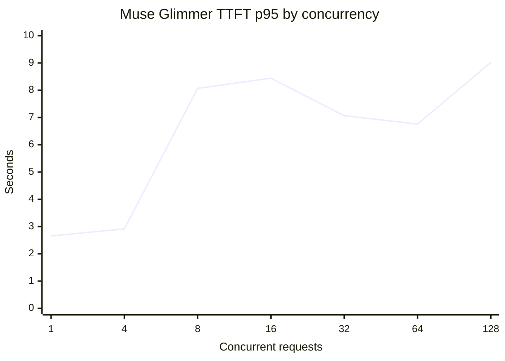

# Muse Glimmer concurrency ramp

Runs used an 8,192-token prompt, 32 generated tokens, BF16, and an A100-80GB. TTFT is measured from request enqueue to the first token returned by `LLMEngine.step()`. Allocator peaks come from `torch.cuda.memory_stats` inside the vLLM model worker after resetting peak stats post-initialization. KV bytes are derived from the trace's 2 MiB page allocations, not vLLM's physical block table. The separate GPU delta is a 50 ms device-wide free-memory sample and includes model weights and the preallocated KV pool. TTFT and worker allocator data were captured in repeat runs at the same concurrency settings.

| Concurrency | TTFT p50 (s) | TTFT p95 (s) | Derived KV page bytes | Worker allocated peak (GiB) | Worker reserved peak (GiB) | OOM |
|---:|---:|---:|---:|---:|---:|---|
| 1 | 2.656 | 2.656 | 208 MiB | 71.00 | 71.33 | no |
| 4 | 2.912 | 2.913 | 832 MiB | 71.00 | 71.45 | no |
| 8 | 8.066 | 8.068 | 1,664 MiB | 71.01 | 71.47 | no |
| 16 | 8.437 | 8.441 | 3,328 MiB | 70.99 | 71.48 | no |
| 32 | 7.058 | 7.065 | 6,656 MiB | 71.00 | 71.55 | no |
| 64 | 6.744 | 6.757 | 13,312 MiB | 71.00 | 71.67 | no |
| 128 | 8.983 | 9.018 | 26,624 MiB | 71.01 | 71.80 | no |

## What the ramp shows

No OOM occurred through 128 submitted requests. vLLM preallocates a roughly 13.5 GiB KV pool that the startup logs estimate can hold about 32 full-length 8,480-token sequences at once. Beyond that, the scheduler queues work and reuses the pool; increasing request count does not force additional KV allocation until the queue drains. The experiment therefore finds queueing/latency behavior, not a GPU OOM threshold. To measure an OOM boundary, the workload would need to change the active KV demand or disable/alter the serving scheduler, which would be a different experiment.

The TTFT values are single observations per concurrency and include JIT/warmup effects; the non-monotonic curve needs repeated trials before claiming a precise latency cliff. The CUDA allocator event trace still has no per-block alloc/free events because the pool is preallocated, but worker-side allocated/reserved peak counters now provide allocator high-water.
